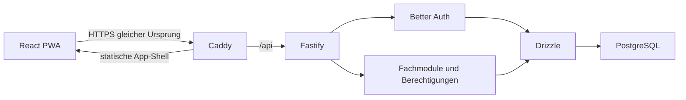

# Architektur

## Modularer Monolith

Bun 1.3.14 verwaltet Workspaces und startet zunächst die API. React/TypeScript und Vite erzeugen eine statische PWA. Fastify verarbeitet REST und delegiert Authentifizierung an Better Auth mit Drizzle-Adapter. PostgreSQL ist die einzige notwendige externe Laufzeitkomponente; Caddy übernimmt TLS, statische Dateien und Reverse Proxy. Es besteht keine produktive SaaS-Abhängigkeit.

`packages/contracts` enthält Zod-Verträge, gemeinsame Typen, Berechtigungen und Statusregeln. `packages/db` besitzt Schema und Migrationen. `apps/api` enthält App-Factory, Zugriffskontrolle und Fachmodule; der Mitglieder-Service ist unabhängig vom HTTP-Server testbar. `apps/web` besitzt API-Client, Query-Cache, Navigation und Formulare. Infrastruktur und CI bleiben außerhalb der Fachmodule. Gemeinsamer TypeScript-Strict-Modus schließt `noUncheckedIndexedAccess` ein.

## Fachliche Grenzen

Eine Person beschreibt einen Menschen, ein Benutzerkonto einen Zugang. Eine Mitgliedschaft verbindet eine Person mit dem Verein und trägt Nummer, Art, Status und Daten. Vereinsfunktionen sind zeitlich gebundene Vorstandsmandate. Login und Vereinsmitgliedschaft sind weder identisch noch zwingend miteinander verknüpft.

Der Endpunkt `members` ist eine explizite Projektion aus `persons` und `memberships`. `splitMember()` trennt die Eingabe. Anlegen und Ändern sperren bzw. schreiben die fachlichen Datensätze und den Audit-Eintrag innerhalb derselben Transaktion. PATCH-Eingaben enthalten keine impliziten Standardwerte; vor dem Schreiben wird der vollständige zusammengeführte Datensatz erneut validiert. Mitgliedsnummern sind pro Organisation eindeutig. Phase 1 führt einen Mitgliedschaftsdatensatz pro Person/Organisation; historische Wiedereintritte erfordern später eine eigene Historientabelle oder mehrere Mitgliedschaftsperioden (bewusste Entscheidung, keine stille Datenüberschreibung).

## Mandantenkontext

Eine authentifizierte Anfrage wählt optional `X-Organization-Id`. Ohne Header wird die erste berechtigte Organisation deterministisch verwendet. Der Server prüft jede Anfrage gegen aktuelle `organization_user_roles`. Ein fremder oder ungültiger Kontext wird abgewiesen. Organisationen in URL-Parametern müssen zusätzlich mit dem autorisierten Kontext übereinstimmen. IDs im Request-Body können den Kontext nicht überschreiben.

API-Filter und zusammengesetzte Fremdschlüssel wirken zusammen. Phase 1 verwendet keine PostgreSQL-RLS; neue Services müssen denselben Kontext explizit übernehmen und Cross-Tenant-Tests besitzen. Der Datenbankzugang ist kein öffentlicher Clientzugang. Neue Module erhalten `organization_id`, Prüfverträge und Audit-Einträge bereits bei ihrer Einführung.

## Frontend

React Router bildet geschützte Seiten ab. Serverseitige Rechte sind maßgeblich; die UI blendet nicht erlaubte Aktionen zusätzlich aus. TanStack Query speichert Daten ausschließlich im Arbeitsspeicher und wird bei Abmeldung, Sitzungsablauf und Organisationswechsel geleert. Es gibt keine persistierte Query-Hydration. React Hook Form/Zod validiert die umfangreichen Mitgliederformulare; gemeinsame Zod-Verträge prüfen auch die übrigen Formulare. i18next liefert DE/IT mit gemeinsamem Schlüsselumfang. Sprache und Darstellungsmodus werden lokal gespeichert.

Die Oberfläche nutzt Sidebar ab Desktopbreite und Bottom-Navigation auf Mobilgeräten. Native Dialoge kapseln Tastaturfokus, semantische Tabellen bleiben auf kleinen Geräten horizontal scrollbar, sichtbare Fokusmarkierungen und Lade-/Leer-/Fehlerzustände sind durchgehend vorgesehen. Keine externen Fonts oder Tracker sind nötig.

## Offline und Erweiterungen

Workbox precacht ausschließlich Build-Dateien. API-Navigation ist vom SPA-Fallback ausgeschlossen und besitzt `Cache-Control: no-store`. Dexie hat in Phase 1 nur eine Shell-Metadaten-Tabelle; der personenbezogene Offline-Store aus Sprint 2.3 ist davon getrennt. App-Updates werden angeboten und erst nach Zustimmung aktiviert.

Die allgemeine Erweiterungsstrategie sieht pro Fachmodul eine lokale Datenprojektion vor und verwendet eine Outbox mit UUID-Operationen, Idempotency-Key, Versionsnummer und Organisations-/Benutzerbindung. Ein dedizierter Sync-Service überträgt bei geöffneter App, `online` und erneuter Anmeldung; Background Sync ist eine optionale Optimierung. Rollenentzug, Konflikte, Geräteverlust und Abmeldung müssen vor der ersten personenbezogenen Offline-Funktion gelöst werden. Siehe Roadmap.

## Node-Kompatibilität

Die API verwendet Fetch-, Node- und PostgreSQL-Schnittstellen, keine Bun-spezifischen Server-, SQL- oder Passwort-APIs. Der Build bündelt Workspace-Code für Node und lässt Drittbibliotheken extern. Bun bleibt Paket-/Buildwerkzeug; die API kann nach `bun run build` auch als `node --env-file=.env apps/api/dist/server.js` gestartet werden. Laufzeit und Werkzeugkette werden separat getestet.

## Sprint 2.3 – konkrete Offline-Projektion

Das Veranstaltungsmodul verwendet separate Serien und Instanzen. Personen ohne Mitgliedschaft können autorisiert als Gäste teilnehmen. Registrierungs-/Anwesenheitsoperationen sind organisationsgebundene Datenbanktransaktionen mit Idempotenz, Versionen und Audit. Vorhandene Rollen und private Dokumente werden erweitert; es gibt keine Kopie des Finanzmoduls und keine impliziten Veranstaltungsbuchungen.

Die explizite Vorbereitung liefert minimale Teilnehmerdaten. Die separate Dexie-Datenbank `bnature-attendance` enthält AES-GCM-verschlüsselte Kopien und eine persistente Outbox, gebunden an Benutzer und Organisation. Die App-Shell lädt die Offline-Ansicht ohne simulierte Session. Der Server prüft bei der Synchronisierung aktuelle Rechte und Versionen neu. Der Browser zeigt lokale/Serverwerte und verlangt manuelle Konfliktauflösung. Ablauf, Logout und erkannter Rechteentzug bereinigen die Daten; Einschränkungen zu geschlossenem Browser und Geräteschutz stehen in [ADR 0004](decisions/0004-events-offline.md).

## Sprint 2.4 – Freiwillige, Register und Compliance

Das API-Modul `apps/api/src/modules/volunteers/` trennt operative Tätigkeiten (`engagements.ts`, `work.ts`), Versicherungen (`insurance.ts`), das gesetzliche Register mit Ständen (`register.ts`) und Fristen (`compliance.ts`). Schreibvorgänge verwenden das bestehende idempotente Operationsprotokoll, speichern dort aber nur IDs und lesen Antworten frisch. Registerdateien und Nachweise laufen über den privaten Dokumentenspeicher; `services/signature.ts` ist die Schnittstelle für spätere qualifizierte Signatur- und Zeitstempeldienste. Gemeinsame Regeln (Zuordnungsprüfung, Stunden, Fristberechnung, Registerpflichtangaben) liegen in `packages/contracts` und sind ohne Datenbank testbar.
